# NetDiagBench-L7: Benchmark Agéntico para Diagnóstico de Fallas Layer 7 sobre IP con SLMs Locales

[](https://www.python.org/)
[](LICENSE)
[-purple.svg)](#)
[](#)
[](docs/INFORME_SEGURIDAD.md)
[](docs/MATRIZ_CIFRAS_OFICIALES_TESIS.md)

> **Trabajo de Grado - Universidad de Pamplona**  
> **Facultad de Ingenierías y Arquitectura | Departamento de Eléctrica, Electrónica, Sistemas y Telecomunicaciones (E.E.S.T.)**  
> **Autor:** Juan David León Arrieta (`juan.leon22@unipamplona.edu.co`)  
> **Director:** Mg. Richard Eliseo Mendoza Gáfaro  
> **Documento de Tesis:** *Benchmark reproducible para el diagnóstico de fallas en servicios de capa de aplicación sobre IP con modelos de lenguaje ligeros de ejecución local*

---

## 1. Descripción del Proyecto y Problema de Investigación

En la operación de infraestructura de telecomunicaciones y centros de datos modernos, el aislamiento expedito de incidentes en la **Capa de Aplicación (Layer 7 del modelo OSI)** —específicamente en servicios esenciales como **DNS (RFC 1035)**, **HTTP/HTTPS (RFC 9110)** y **TLS (RFC 8446)**— constituye un desafío crítico. Aunque los Modelos de Lenguaje de Gran Escala (LLMs) propietarios han demostrado capacidades avanzadas de razonamiento, su adopción en operaciones de red (NOC/SOC) se encuentra severamente restringida por:

1. **Riesgos de Fuga de Información y Privacidad:** Exposición de topologías, credenciales y telemetría interna hacia nubes de terceros.
2. **Dependencia de Conectividad Externa:** Imposibilidad de operar durante fallas masivas de enlace o en redes estrictamente aisladas (*air-gapped*).
3. **Altos Costos de Inferencia y Huella Energética:** Consumo inviable de recursos frente a modelos locales.

**NetDiagBench-L7** surge como el primer marco experimental integral y reproducible diseñado para evaluar y comparar rigurosamente el desempeño de **Modelos de Lenguaje Pequeños (SLMs, $\le 9\text{B}$ parámetros)** ejecutados de forma **100% local** bajo hardware restringido ($\le 8\text{ GB}$ VRAM), para el diagnóstico asistido de fallas de Capa 7.

---

## 2. Arquitectura del Sistema en Ocho Capas Desacopladas

El sistema se estructura en **8 capas funcionales independientes**, gobernadas por contratos estrictos de datos mediante Pydantic:

```mermaid
graph TD
    subgraph L1["Capa 1: Laboratorio y Emulación (ScenarioLabAgent)"]
        CLAB["Contenedores Docker / BIND9 / Nginx / tc-netem"] -->|"escenario.yaml + Logs Crudos"| L2
    end

    subgraph L2["Capa 2: Pipeline y Preprocesamiento (DataPipelineAgent)"]
        FB["Drain3 (Minería de Plantillas) + Ventana Deslizante Contextual"] -->|"ventana.jsonl"| L3
    end

    subgraph L3["Capa 3: RAG Léxico Acotado (RAGKnowledgeAgent)"]
        BM25["Recuperador BM25 Acotado (RAM <= 0.05 MB, RFCs 1035/9110/8446)"] -->|"contexto.md"| L4
    end

    subgraph L4["Capa 4: Inferencia Local y Telemetría (InferenceEngineAgent)"]
        OLLAMA["Ollama Local (GGUF Q4_K_M) + Medición TTFT/tok_s/RAM"] -->|"diagnostico.json + Telemetría"| L5
    end

    subgraph L5["Capa 5: Orquestación Agéntica (DiagnosticOrchestratorAgent)"]
        LG["Grafo LangGraph + Herramientas Read-Only (dig, curl, openssl)"] -->|"traza.jsonl"| L6
    end

    subgraph L6["Capa 6: Interfaces de Usuario (InterfaceCLIAgent)"]
        CLI["Typer CLI + Dashboard Web Reactivo (FastAPI + HTMX + SVG)"] -->|"Reportes HTML/PDF/Excel"| L7
    end

    subgraph L7["Capa 7: Evaluación y MLOps (BenchmarkEvaluatorAgent)"]
        EVAL["Métricas Multiclase K=18, Friedman, Wilcoxon-Holm, Bootstrap N=1000"] -->|"resultados.csv + Matrices"| L8
    end

    subgraph L8["Capa 8: Validación Humana (HumanValidationAgent)"]
        HUMAN["Panel Doble Ciego E1/E2 + Adjudicador E3 + Kappa/Spearman"] -->|"evaluaciones_adjudicadas.csv"| MATRIZ["Matriz Oficial de Cifras"]
    end
```



### Contratos de Datos y Artefactos por Capa

| Capa | Módulo | Artefacto Generado | Estándar / Tecnología | Restricción Clave |
|---|---|---|---|---|
| **Capa 1** | `src/layer1_lab/` | `escenario.yaml` | Docker, BIND9, Nginx, `tc netem` | Aislamiento de red de pruebas |
| **Capa 2** | `src/layer2_pipeline/` | `ventana.jsonl` | Drain3, Jinja2 | Minería determinista de logs |
| **Capa 3** | `src/layer3_rag/` | `contexto.md` | BM25 Okapi léxico acotado | Consumo de memoria $\le 0.05\text{ MB}$ RAM |
| **Capa 4** | `src/layer4_inference/` | `respuesta.json` | Ollama, cuantización GGUF `Q4_K_M` | Temperatura `0.0`, Top-P `0.9` |
| **Capa 5** | `src/layer5_orchestrator/` | `traza.jsonl` | LangGraph StateGraph | Herramientas **estrictamente de solo lectura** |
| **Capa 6** | `src/layer6_interface/` | Informes Web/CLI | FastAPI, HTMX, Typer, ReportLab | Seguridad OWASP y anti-SSRF |
| **Capa 7** | `src/layer7_evaluator/` | `resultados.csv` | SciPy, Statsmodels, Scikit-learn | $N=18$ clusters, Bootstrap pareado |
| **Capa 8** | `src/layer8_human_eval/` | `evaluaciones_adjudicadas.csv` | Rúbrica $C_1-C_6, S$, Kappa, ICC(2,1) | Doble ciego independiente anonimizado |

---

## 3. Terna Oficial de Modelos SLM Evaluados

De acuerdo con la caracterización inicial de 12 modelos (Entregable E1), se seleccionó una terna representativa en el rango de parámetros $\le 9\text{B}$:

| Modelo | Tag Ollama Oficial | Parámetros | Licencia | Cuantización Efectiva | Digest SHA-256 Verificado |
|---|---|:---:|:---:|:---:|---|
| **GLM-4-9B-Chat** | `glm4:9b-chat-q4_K_M` | 9.0B | GLM-4 License | `Q4_0` (Blob GGUF) | `5b699761eca535dc55047ad9d2dbf54e3b8697709419ef78a70503ed4bfbcf44` |
| **Qwen3-8B** | `qwen3:8b` | 8.2B | Apache 2.0 | `Q4_K_M` | `500a1f067a9f782620b40bee6f7b0c89e17ae61f686b92c24933e4ca4b2b8b41` |
| **Phi-4-mini-instruct** | `phi4-mini:latest` | 3.8B | MIT | `Q4_K_M` | `78fad5d182a7c33065e153a5f8ba210754207ba9d91973f57dffa7f487363753` |

---

## 4. Diseño Experimental Oficial y Resultados Congelados

La campaña oficial consta de **162 corridas experimentales controladas** (18 escenarios $\times$ 3 modelos $\times$ 3 semillas deterministas: `42`, `1337`, `2026`).

### 4.1. Resumen Global de Exactitud Diagnóstica

| Modelo | Diagnóstico Completo (`full_text`) | Exactitud Completa (%) | Causa Raíz Estricta (`root_cause`) | Exactitud Estricta (%) | Coincidencia de Clase Canónica | Exactitud Canónica (%) |
|---|:---:|:---:|:---:|:---:|:---:|:---:|
| **GLM-4-9B-Chat** | **40 / 54** | **74.1%** | **33 / 54** | **61.1%** | **40 / 54** | **74.1%** |
| **Qwen3-8B** | **47 / 54** | **87.0%** | **24 / 54** | **44.4%** | **47 / 54** | **87.0%** |
| **Phi-4-mini-instruct** | **35 / 54** | **64.8%** | **14 / 54** | **25.9%** | **33 / 54** | **61.1%** |
| **TOTAL BENCHMARK** | **122 / 162** | **75.3%** | **71 / 162** | **43.8%** | **120 / 162** | **74.1%** |


*Nomenclatura Canónica en Dataset:* Diagnóstico Completo (`is_full_diagnosis_correct` = 122/162, 75.3%), Causa Raíz Estricta (`is_root_cause_correct` = 71/162, 43.8%), Coincidencia Canónica (`fault_class_match` = 120/162, 74.1%), Evidencia Read-Only (`evidence_backed` = 38/162, 23.5%).
*Desglose de auditoría sobre las 162 ejecuciones:*
- Aciertos directos conservados: **71** (43.8%)
- Aciertos fundamentados demostrables corregidos: **51** (31.5%)
- Errores confirmados: **40** (24.7%)

### 4.2. Tasa de Evidencia Empírica de Solo Lectura (Read-Only)

El criterio de sustentación $S = \text{True}$ exige que el agente ejecute de forma efectiva herramientas de lectura (`dig`, `curl`, `openssl`), recolecte evidencia factual de red verificable y no contradiga el diagnóstico emitido:

| Modelo | Corridas con Evidencia Válida | Tasa de Evidencia Read-Only |
|---|:---:|:---:|
| **GLM-4-9B-Chat** | **23 / 54** | **42.6%** |
| **Qwen3-8B** | **15 / 54** | **27.8%** |
| **Phi-4-mini-instruct** | **0 / 54** | **0.0%** |
| **TOTAL BENCHMARK** | **38 / 162** | **23.46% (≈ 23.5%)** |

*Interpretación técnica de la tasa del 23.5%:*  
Refleja la complejidad intrínseca de orquestación de herramientas autónomas en SLMs pequeños. GLM-4-9B exhibe la mayor competencia de invocación de herramientas (42.6%), Qwen3-8B alcanza un 27.8% apoyado en su razonamiento nativo, mientras que Phi-4-mini no logró emitir esquemas sintácticamente válidos de invocación de herramientas en el entorno de pruebas, fundamentando sus diagnósticos exclusivamente en el texto de los logs.

### 4.3. Evaluación Multicriterio y Dictamen de Elegibilidad Técnica

Fórmula ponderada del Scorecard Multicriterio:
$$S = 0.40 \cdot A_{\text{diag}} + 0.20 \cdot R_{\text{hum}} + 0.20 \cdot V_{\text{vel}} + 0.20 \cdot M_{\text{vram}}$$
*Umbral mínimo obligatorio de viabilidad técnica para operaciones autónomas:* $A_{\text{diag}} \ge 70.0\%$.

| Modelo | Diagnóstico (40%) | Rúbrica (20%) | Velocidad (20%) | VRAM (20%) | Puntaje Compuesto | Umbral $\ge 70\%$ | Dictamen de Elegibilidad |
|---|:---:|:---:|:---:|:---:|:---:|:---:|---|
| **GLM-4-9B-Chat** | 0.2964 | 0.1652 | 0.1758 | 0.0949 | **0.7323** | **Sí (74.1%)** | **ELEGIBLE (Mejor Compromiso Global - NOC)** |
| **Qwen3-8B** | 0.3480 | 0.1628 | 0.1091 | 0.1018 | **0.7217** | **Sí (87.0%)** | **ELEGIBLE (Mayor Exactitud - Recursos Acotados)** |
| **Phi-4-mini-instruct** | 0.2592 | 0.1420 | 0.2000 | 0.2000 | **0.8012** | **No (64.8%)** | **NO ELEGIBLE (Sub-umbral para diagnóstico autónomo)** |

---

## 5. Pruebas de Hipótesis e Inferencia Estadística

- **Prueba Global de Friedman ($N=18$ bloques de escenarios):**  
  $\chi^2 = 6.8205$, $gl = 2$, $p = 0.03303 < 0.05$. Se rechaza la hipótesis nula: existen diferencias estadísticamente significativas entre los modelos.
- **Contrastes Pareados de Wilcoxon con Ajuste Holm-Bonferroni (Familia $m=3$):**
  - Qwen3-8B vs. Phi-4-mini: $W = 10.5, p_{\text{adj}} = 0.041$ (Significativo a favor de Qwen3-8B).
  - GLM-4-9B vs. Phi-4-mini: $W = 48.0, p_{\text{adj}} = 0.370$ (No significativo).
  - GLM-4-9B vs. Qwen3-8B: $W = 12.0, p_{\text{adj}} = 0.053$ (Marginalmente no significativo a $\alpha = 0.05$).
- **Remuestreo Bootstrap por Conglomerados ($B=1000$ réplicas, semilla 42):**
  - GLM-4-9B-Chat: Exactitud IC 95% = `[59.3%, 87.0%]`, F1 Macro = `[0.564, 0.860]`.
  - Qwen3-8B: Exactitud IC 95% = `[74.1%, 98.2%]`, F1 Macro = `[0.638, 0.963]`.
  - Phi-4-mini-instruct: Exactitud IC 95% = `[53.7%, 75.9%]`, F1 Macro = `[0.497, 0.720]`.

---

## 6. Instalación y Puesta en Marcha

### Requisitos del Sistema
- **Python:** 3.11, 3.12 o 3.13.
- **Docker y Docker Compose:** (Requerido para escenarios emulados de laboratorio).
- **Ollama:** Servidor local de inferencia (`http://localhost:11434`).
- **Hardware Recomendado:** CPU 8 núcleos, $\ge 16\text{ GB}$ RAM, GPU dedicada de 8 GB VRAM (compatible con CUDA/ROCm).

### 6.1. Clonar el Repositorio e Instalar Dependencias
```bash
# 1. Clonar el repositorio
git clone https://github.com/leonarrietaj-ux/NetDiagBench-L7.git
cd NetDiagBench-L7

# 2. Crear y activar entorno virtual
python -m venv .venv

# En Linux / macOS:
source .venv/bin/activate
# En Windows (PowerShell):
.\.venv\Scripts\Activate.ps1

# 3. Instalar dependencias
pip install --upgrade pip
pip install -r requirements.txt
pip install -e . --no-deps
```

### 6.2. Aprovisionar Certificados de Prueba Locales
```bash
python scripts/generate_test_certs.py
```

### 6.3. Descargar Modelos en Ollama
```bash
ollama pull qwen3:8b
ollama pull glm4:9b-chat-q4_K_M
ollama pull phi4-mini:latest
```

---

## 7. Ejecución del Aplicativo y Casos de Uso

### 7.1. Suite de Pruebas Automatizadas
```bash
# Ejecutar todas las pruebas unitarias y de contratos
pytest tests/ -v

# Ejecutar auditoría de seguridad
pytest tests/test_security_audit.py -v

# Ejecutar validaciones estadísticas
pytest tests/test_statistical_analysis.py -v
```

### 7.2. Interfaz de Línea de Comandos (`benchapp`)
```bash
# Listar los 18 escenarios del catálogo
benchapp list-scenarios

# Listar la terna de modelos
benchapp list-models

# Ejecutar el diagnóstico de un escenario individual
benchapp run-scenario DNS-NXD-01 --model qwen3-8b --seed 42

# Ejecutar análisis de correlación estadística
benchapp analyze-correlation

# Validar integridad del catálogo
benchapp validate-catalog
```

### 7.3. Panel Web Interactivo (FastAPI + HTMX)
```bash
# Iniciar el servidor web
benchapp serve-dashboard --port 8000

# Abrir en el navegador:
# http://localhost:8000
```

---

## 8. Arquitectura de Seguridad y Hardening

El marco incorpora una arquitectura de seguridad por capas (*Defense-in-Depth*):
1. **Herramientas de Red Read-Only:** El orquestador opera únicamente utilidades de inspección no invasivas (`dig`, `curl`, `openssl`).
2. **Protección Anti-SSRF Multicloud:** Bloqueo explícito de metadatos de proveedores en la nube (AWS `169.254.169.254`, GCP, Alibaba, Tencent) y CoreDNS de Kubernetes.
3. **Cabeceras HTTP OWASP:** Implementación en middleware de CSP estricto, `X-Frame-Options: SAMEORIGIN`, `X-Content-Type-Options: nosniff` y `Permissions-Policy`.
4. **Sanitización Estricta:** Mitigación de inyecciones de comandos en llamadas a subprocesos mediante expresiones regulares de control.

Consulte el informe completo en [docs/INFORME_SEGURIDAD.md](docs/INFORME_SEGURIDAD.md).

---

## 9. Estructura del Repositorio

```text
NetDiagBench-L7/
├── .github/workflows/ci.yml       # Integración continua automatizada
├── configs/                       # Definición de modelos, escenarios y rúbrica
├── data/
│   ├── benchmark_results/         # Conjunto de datos consolidado oficial
│   ├── campaign_162/              # 162 corridas oficiales con trazas y hashes
│   └── human_eval/                # Evaluaciones humanas adjudicadas anonimizadas
├── docs/                          # Documentación académica, manuales y matrices
│   ├── GUIA_REPRODUCIBILIDAD.md
│   ├── MANUAL_TECNICO_SISTEMA.md
│   ├── MANUAL_USUARIO_SISTEMA.md
│   ├── MATRIZ_CIFRAS_OFICIALES_TESIS.md
│   └── INFORME_SEGURIDAD.md
├── infra/                         # Topologías Docker para pruebas emuladas
├── knowledge/                     # RFCs y corpus normativo para RAG léxico
├── scenarios/                     # Catálogo de 18 escenarios de fallas Layer 7
├── scripts/                       # Utilidades de prueba, certificados y reportes
├── src/                           # Código fuente del sistema en 8 capas
├── tests/                         # Suite completa de pruebas automatizadas
├── Dockerfile                     # Imagen de contenedor del aplicativo
├── docker-compose.yml             # Despliegue orquestado del entorno
├── pyproject.toml                 # Configuración de paquete PEP 621
├── requirements.txt               # Dependencias fijadas del proyecto
├── CITATION.cff                   # Metadatos para citación académica
├── LICENSE                        # Licencia de código abierto MIT
└── README.md                      # Documento principal del repositorio
```

---

## 10. Licencia y Citación

Este proyecto se distribuye bajo la licencia **MIT**. Consulte el archivo [LICENSE](LICENSE) para mayores detalles.

Si utiliza este benchmark o sus conjuntos de datos en investigaciones académicas, cite este trabajo utilizando el formato [CITATION.cff](CITATION.cff):

```bibtex
@misc{leon2026netdiagbench,
  author = {León Arrieta, Juan David and Mendoza Gáfaro, Richard Eliseo},
  title = {NetDiagBench-L7: Benchmark Reproducible para Diagnóstico de Fallas en Servicios de Capa de Aplicación sobre IP con SLMs Locales},
  year = {2026},
  publisher = {GitHub},
  howpublished = {\url{https://github.com/leonarrietaj-ux/NetDiagBench-L7}}
}
```
