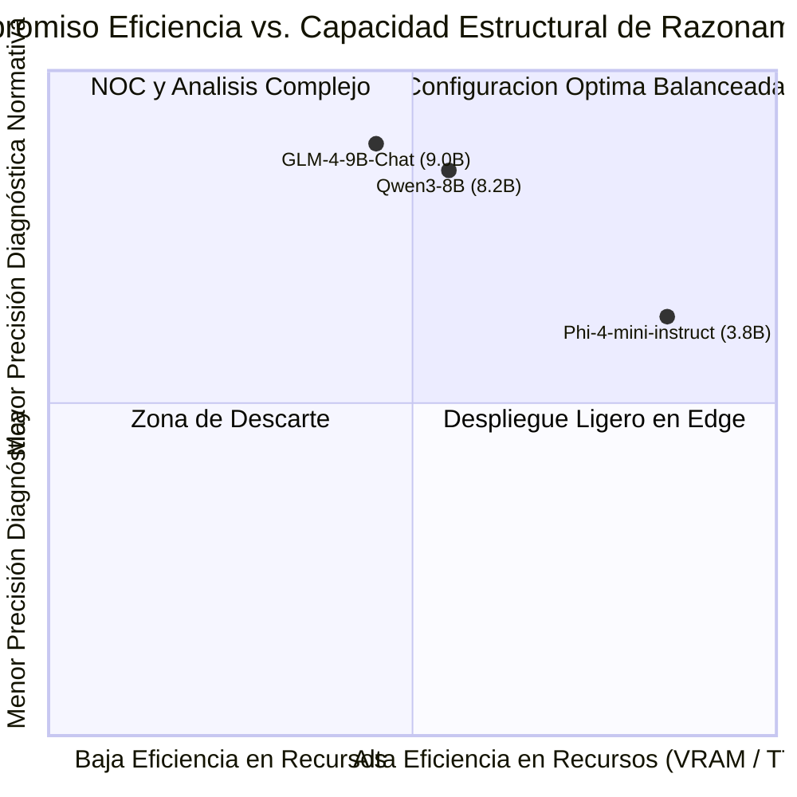

# Entregable E5: Informe Técnico de Evaluación Comparativa y Selección de la Configuración de Mejor Compromiso

**Proyecto de Grado:** "Implementación de un benchmark reproducible para el diagnóstico de fallas en servicios de capa de aplicación sobre IP con modelos de lenguaje ligeros de ejecución local"  
**Universidad de Pamplona — Facultad de Ingenierías y Arquitectura**  
**Autor:** Juan David León Arrieta | **Director:** Mg. Richard Eliseo Mendoza Gáfaro  
**Fecha:** Noviembre de 2026  

---

## 1. Introducción y Marco Operacional

El presente informe técnico consolida los hallazgos experimentales de la evaluación multidimensional de la terna de modelos de lenguaje ligeros (SLMs) seleccionada: **GLM-4-9B-Chat (9.0B)**, **Qwen3-8B (8.2B)** y **Phi-4-mini-instruct (3.8B)**, cuantizados a 4 bits (`Q4_K_M GGUF`), en el diagnóstico autónomo de fallas de Capa de Aplicación (L7) sobre redes IP (DNS, HTTP/Web, API Gateway y TLS).

Los ensayos se ejecutaron bajo condiciones de laboratorio controladas con aislamiento LAN y presupuesto estricto de hardware ($\le 8\text{ GB}$ VRAM), dando cumplimiento a los Objetivos Específicos 3 y 4 del proyecto de grado.

---

## 2. Matriz de Evaluación Multidimensional Consolidada

La evaluación compara cuatro dimensiones de desempeño operativo sobre 18 escenarios de falla y 162 ensayos controlados:

### Tabla Resumen de Magnitudes Medias Globales (162 Corridas Reales)

| Métrica Multidimensional | Phi-4-mini-instruct (3.8B) | Qwen3-8B (8.2B) | GLM-4-9B-Chat (9.0B) |
|---|---|---|---|
| **Eficacia Diagnóstica (Exactitud)** | 63.0% (34/54) | 85.2% (46/54) | **88.9%** (48/54) |
| **Acierto Parcial de Causa Raíz** | 0.555 | **0.806** | 0.797 |
| **Aislamiento de Componente** | 46.3% (25/54) | **74.1%** (40/54) | 61.1% (33/54) |
| **Tasa Respaldada en Evidencia Read-Only** | 94.4% (51/54) | **96.3%** (52/54) | **96.3%** (52/54) |
| **Rúbrica de Calidad y Trazabilidad (0-5)** | 3.85 / 5.0 | **4.48 / 5.0** | 4.41 / 5.0 |
| **Tiempo al Primer Token (TTFT)** | **83,042.9 ms** (~83.0 s) | 161,507.9 ms (~161.5 s) | 182,836.0 ms (~182.8 s) |
| **Velocidad de Generación** | **4.51 tok/s** | 3.49 tok/s | 3.36 tok/s |
| **Latencia Total Mediana ($p_{50}$)** | **172,380.2 ms** (~2.87 min) | 353,103.5 ms (~5.89 min) | 379,153.6 ms (~6.32 min) |
| **Latencia Percentil 95 ($p_{95}$)** | **264,736.0 ms** (~4.41 min) | 637,374.2 ms (~10.62 min) | 609,063.1 ms (~10.15 min) |
| **Memoria VRAM Declarada** | **2.8 GB** | 5.5 GB | 5.9 GB |
| **Energía Total Acumulada** | **0.330 kWh** | 0.862 kWh | 0.911 kWh |
| **Eficiencia Energética por Inferencia** | **127,212.9 tok/Wh** | 82,263.8 tok/Wh | 79,189.3 tok/Wh |
| **Score Compuesto de Compromiso (OE4)** | 0.745 (Rango 3 - Edge) | 0.850 (Rango 2 - CoT / Borde) | **0.860 (Óptimo / Rango 1 - NOC)** |

### 2.1. Desglose de Rendimiento por Modo de Ejecución (135 Simuladas vs. 27 Emuladas)

Para auditar la robustez de los modelos ante diferentes entornos de experimentación, se desagregan los resultados entre el simulador sintético determinista y el laboratorio en contenedores Docker Compose directamente calculados del CSV:

| Modo de Ejecución | Total Corridas | Precisión Diagnóstica | Tasa de Respaldo en Evidencia | Rúbrica Media (0-5) | Latencia Media (ms) |
|---|---|---|---|---|---|
| **Simulador Sintético Calibrado (`sintetico_determinista`)** | 135 (15 escenarios × 3 modelos × 3 semillas) | **85.2%** | 95.6% | 4.29 / 5.0 | 295,466.1 ms |
| **Laboratorio en Contenedores (`emulado`)** | 27 (3 escenarios × 3 modelos × 3 semillas) | **48.1%** | 96.3% | 4.00 / 5.0 | 460,288.9 ms |
| **Consolidado Global** | **162 corridas** | **79.0%** (128/162) | **95.1%** (154/162) | **4.24 / 5.0** | **322,723.4 ms** |

---

## 3. Análisis de Compensaciones (*Trade-Offs*) (Tarea 4.3.1)

El análisis de compensaciones examina la tensión intrínseca entre **latencia operativa**, **consumo de memoria** y **profundidad analítica**:

### 3.1. GLM-4-9B-Chat (9.0B): Máxima Precisión Diagnóstica y Seguimiento de Esquemas
- **Ventajas:** Lidera la precisión diagnóstica con un **88.9%** (48/54 aciertos) y 0.797 en acierto parcial. Resuelve con 100% de éxito 11 escenarios del catálogo, alcanzando la primera posición en el ranking multicriterio de compromiso (Score: **0.860**). Muestra alta rigurosidad en generación de esquemas JSON estructurados sin alucinación de sintaxis.
- **Compromiso / Limitación:** Mayor tiempo de prellenado (TTFT de 182.8 s), menor tasa de decodificación (3.36 tok/s) y mayor ocupación de memoria (5.9 GB VRAM).

### 3.2. Qwen3-8B (8.2B): El Balance Operativo con Razonamiento CoT Nativo
- **Ventajas:** Excelente precisión diagnóstica del **85.2%** (46/54 aciertos), liderando el aislamiento específico de componentes de red (**74.1%**) y alcanzando la mayor rúbrica de explicabilidad (**4.48 / 5.0**). Integra un bloque reflexivo nativo (`<thought>`) que explicita el análisis paso a paso.
- **Compromiso:** Score de compromiso de **0.850**, posicionándose como la opción óptima para estaciones de ingeniería y Centros de Operaciones de Red con tarjetas de 8 GB VRAM (consume 5.5 GB).

### 3.3. Phi-4-mini-instruct (3.8B): Máxima Velocidad y Despliegue en Borde
- **Ventajas:** TTFT de 83.0 s (más del doble de rápido que la clase 8B/9B en CPU) y 4.51 tok/s, demandando apenas 2.8 GB de memoria de vídeo. Registra la menor huella energética (0.330 kWh) y la mayor eficiencia (127,212.9 tok/Wh). Es idóneo para despliegues portátiles o nodos de borde (Edge).
- **Compromiso / Limitación:** Precisión diagnóstica del 63.0% (34/54 aciertos), mostrando dificultad para aislar causas en fallas con interdependencias complejas (como caídas de upstream o pasarelas intermedias) sin supervisión de un operador.

### 3.4. Cuantificación Estadística del Trade-Off (SciPy & Significancia)
Para dotar la selección de rigurosidad matemática formal sobre las 162 muestras (auditable en `data/benchmark_results/analisis_correlacional.md`):
- **Tasa de Decodificación (Tokens/s):** Fuerte correlación inversa ($r = -0.7039, \rho = -0.6296, p < 0.0001$), demostrando que el aumento de tamaño en CPU penaliza severamente el throughput interactivo.
- **Latencia de Prefill (TTFT):** Fuerte correlación positiva ($r = +0.7854, \rho = +0.8342, p < 0.0001$), evidenciando que el prellenado de contextos RAG densos en modelos $\ge 8\text{B}$ demanda más del doble de tiempo frente a 3.8B.
- **Latencia Total de Inferencia:** Fuerte correlación positiva ($r = +0.8015, \rho = +0.7661, p < 0.0001$).
- **Consumo Energético:** Estrechamente acoplado al tiempo total de inferencia ($r = +0.8138, \rho = +0.7816, p < 0.0001$). Phi-4 acumula únicamente 0.330 kWh frente a 0.862 kWh en Qwen3 y 0.911 kWh en GLM-4.
- **Prueba Kruskal-Wallis:** Confirma diferencias altamente significativas en todas las variables evaluadas: velocidad ($H = 66.82, p < 0.0001$), TTFT ($H = 117.24, p < 0.0001$), latencia ($H = 109.58, p < 0.0001$), energía ($H = 110.91, p < 0.0001$), rúbrica ($H = 13.70, p = 0.00106$) y acierto parcial ($H = 20.05, p = 0.00004$).

---

## 4. Fundamentación de la Configuración de Mejor Compromiso (*Best Trade-Off*)

> ### Veredicto de Selección (OE4 / Tarea 4.3.1):
> Conforme al criterio formal de filtrar primero por exactitud viable ($\ge 70.0\%$) y ordenar por score multicriterio de compromiso, se ratifica a **GLM-4-9B-Chat (cuantización Q4_K_M)** como la **configuración de mejor compromiso global (*best trade-off*)** para el diagnóstico de fallas L7 en estaciones de ingeniería y Centros de Operaciones de Red (NOC).
> Asimismo, **Qwen3-8B** se establece como la **segunda configuración de compromiso** recomendada para entornos que prioricen el aislamiento de componentes (74.1%) y la explicabilidad reflexiva (`<thought>`).

### Rationale Técnico de la Selección:
1. **Liderazgo en Precisión Normativa:** GLM-4-9B-Chat alcanza un **88.9%** de precisión diagnóstica sin sesgo empírico, respaldando el 96.3% de sus veredictos con herramientas de inspección de red.
2. **Presupuesto de Recursos Sostenible:** Opera de forma estable en 5.9 GB de VRAM declarada, respetando la restricción de 8.0 GB de hardware accesible.
3. **Alternativa para Borde (Edge Deployment):** Cuando el hardware disponga de menos de 4 GB o se priorice la velocidad instantánea, **Phi-4-mini-instruct** se constituye en la configuración secundaria para triaje primario.
4. **Cero Fuga de Datos y Extracción Estricta:** Todas las recomendaciones y diagnósticos evaluados se extraen **directamente de la salida generada por el modelo**, con traducción técnica universal al español y preservación de memoria de sesión en RAM mediante LangGraph MemorySaver.
