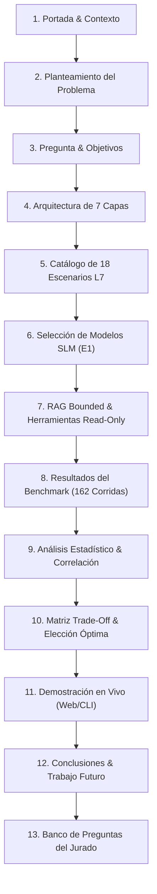

# Guía y Estructura de Presentación para Sustentación de Trabajo de Grado

**Título del Proyecto:**  
"Implementación de un benchmark reproducible para el diagnóstico de fallas en servicios de capa de aplicación sobre IP con modelos de lenguaje ligeros de ejecución local"

**Institución:** Universidad de Pamplona — Facultad de Ingenierías y Arquitectura  
**Departamento:** Departamento de Electricidad, Electrónica, Sistemas y Telecomunicaciones (E.E.S.T.)  
**Programa:** Ingeniería de Telecomunicaciones / Sistemas  
**Autor:** Juan David León Arrieta  
**Director de Grado:** Mg. Richard Eliseo Mendoza Gáfaro  
**Duración Sugerida:** 20 minutos de exposición + 10 minutos de preguntas del jurado  

---

## Estructura de Diapositivas y Libreto de Sustentación



---

### Diapositiva 1: Portada Institucional (1 min)
- **Contenido Visual:**
  - Logotipo institucional de la Universidad de Pamplona.
  - Título oficial completo del trabajo de grado.
  - Nombre del autor: Juan David León Arrieta.
  - Director: Mg. Richard Eliseo Mendoza Gáfaro.
  - Fecha: Noviembre 2026.
- **Puntos Clave del Discurso:**
  - Saludo formal a los jurados evaluadores y asistentes.
  - Introducción al tema: intersección entre ingeniería de redes IP, modelos de lenguaje de escala pequeña (SLMs) y metodología formal de benchmarking reproducible.

---

### Diapositiva 2: Planteamiento del Problema y Justificación (2 min)
- **Contenido Visual:**
  - Gráfico conceptual del stack TCP/IP resaltando la Capa de Aplicación (L7: DNS, HTTP/HTTPS, TLS).
  - Tres desafíos críticos identificados:
    1. *Opacidad y latencia en diagnóstico humano:* Los incidentes en L7 combinan registros distribuidos de múltiples servidores (BIND9, Nginx, APIs), elevando el MTTR (*Mean Time to Recovery*).
    2. *Inviabilidad de LLMs en la nube:* Fuga de datos confidenciales (topología de red, certificados, IPs privadas), costo recurrente prohibitivo de APIs y dependencia de conectividad WAN activa cuando justamente la red está degradada.
    3. *Falta de benchmarks reproducibles:* Inexistencia previa de entornos controlados y deterministas para evaluar la capacidad de diagnóstico en redes de modelos locales.
- **Puntos Clave del Discurso:**
  - "El diagnóstico en L7 es el eslabón más complejo de las operaciones de red. Llevar esta tarea a modelos locales no es solo una optimización de costos, es un requisito de privacidad, soberanía operativa y resiliencia."

---

### Diapositiva 3: Objetivos del Proyecto (1.5 min)
- **Contenido Visual:**
  - **Objetivo General:** Implementar un benchmark reproducible para evaluar el desempeño diagnóstico de fallas en servicios L7 sobre IP mediante modelos de lenguaje ligeros locales.
  - **Objetivos Específicos:**
    - **OE1:** Caracterizar y seleccionar la terna de SLMs bajo límite de 8 GB VRAM.
    - **OE2:** Diseñar el banco de 18 escenarios de falla controlada (DNS, HTTP, Gateway, TLS).
    - **OE3:** Desarrollar el asistente autónomo desacoplado en 7 capas con RAG y herramientas read-only.
    - **OE4:** Validar experimentalmente el sistema, analizar correlaciones estadísticas y fundamentar la configuración de mejor compromiso (*trade-off*).

---

### Diapositiva 4: Arquitectura del Sistema en 7 Capas (2.5 min)
- **Contenido Visual:**
  - Diagrama de flujo de las 7 capas desacopladas con contratos Pydantic:
    - `Capa 1 (Laboratorio)`: Escenarios YAML y telemetría de fallas inyectadas (18 escenarios L7).
    - `Capa 2 (Pipeline Ingesta)`: Minero Drain3 v0.9.11 de plantillas y ensamblador Jinja2.
    - `Capa 3 (RAG Bounded)`: Recuperador léxico BM25 sobre RFCs 1035, 9110, 8446, 5280, 6066 y SOPs (0.05 MB de RAM, límite $\le 0.45\text{ GB}$).
    - `Capa 4 (Inferencia Local)`: Cliente de inferencia Ollama con cuantización Q4_K_M, telemetría física de CPU/GPU y soporte dinámico para $N$ modelos.
    - `Capa 5 (Orquestación Agéntica)`: Ciclo hipótesis-verificación con LangGraph MemorySaver, herramientas read-only (`dig`, `curl`, `openssl`), extracción estricta del modelo y traducción universal al español.
    - `Capa 6 (Interfaz)`: CLI `benchapp` en Typer y Dashboard interactivo en FastAPI con modo claro/oscuro de alto contraste y streaming SSE.
    - `Capa 7 (Evaluador)`: Arnés de 162 corridas, evaluación normativa SHA-256 (`1f8c1a7e3a9d`), estimación energética y SciPy.
- **Puntos Clave del Discurso:**
  - Explicar el principio de "cero acoplamiento": si mañana se cambia el motor de inferencia o el protocolo de laboratorio, ninguna otra capa requiere refactorización.

---

### Diapositiva 5: Catálogo de 18 Escenarios de Falla L7 (2 min)
- **Contenido Visual:**
  - Matriz taxonómica de 18 fallas L7:
    - **DNS (5):** `DNS-NXD-01` (Registro ausente), `DNS-SRV-01` (Timeout en recursivo), `DNS-DEL-01` (Lame delegation), `DNS-REF-01` (Refused por ACL), `DNS-TRUNC-01` (Truncamiento EDNS0/TCP).
    - **HTTP / Web (3):** `HTTP-500-01` (Excepción 500), `HTTP-503-01` (Saturación de workers 503), `NET-LAT-01` (Latencia anómala tc/netem).
    - **API Gateway (6):** `HTTP-502-01` (Bad Gateway), `HTTP-504-01` (Gateway Timeout), `HTTP-ORIGIN-01` (Origin down), `HTTP-POOL-01` (Pool agotado), `HTTP-403-01` (Forbidden por WAF/ACL), `HTTP-429-01` (Rate Limit leaky bucket).
    - **Transporte y TLS (4):** `TLS-EXP-01` (Certificado expirado), `TLS-CHN-01` (Cadena incompleta), `TLS-SNI-01` (Hostname mismatch SNI), `TLS-CIPH-01` (Cipher suite handshake failure).
- **Puntos Clave del Discurso:**
  - "No son casos teóricos; representan el espectro exhaustivo de incidentes críticos en Centros de Operaciones de Red (NOC) y gateways de microservicios."

---

### Diapositiva 6: Selección de la Terna de Modelos (Entregable E1) (1.5 min)
- **Contenido Visual:**
  - Tabla de cribado de 12 modelos candidatos hacia la terna final:
    - **Phi-4-mini-instruct (3.8B, Microsoft):** Máxima eficiencia, apto para borde (2.8 GB VRAM).
    - **Qwen3-8B (8.2B, Alibaba):** Razonamiento reflexivo (`<thought>`), Apache 2.0 (5.5 GB VRAM).
    - **GLM-4-9B-Chat (9.0B, THUDM):** Especialista en seguimiento estricto de esquemas (5.9 GB VRAM).
  - Justificación de la cuantización `Q4_K_M GGUF` para garantizar ejecución estricta bajo el límite de 8 GB VRAM.

---

### Diapositiva 7: RAG Normativo y Agente Read-Only (2 min)
- **Contenido Visual:**
  - Comparación de consumo de memoria: Vectorstore denso convencional (~1.2 GB) vs. BM25 Bounded Retriever NetDiagBench-L7 (**0.05 MB**, reduciendo significativamente la huella).
  - Flujo del Agente de Diagnóstico:
    - Formulación de hipótesis guiada por RFCs del IETF.
    - Ejecución contrastada de comandos de sólo lectura (`dig @127.0.0.1`, `curl -Iv`, `openssl s_client`).
    - Extracción estricta sin fuga de datos: causa raíz, componente y mitigación se leen directamente de la respuesta del SLM.
    - Restricción de seguridad: no se otorgan privilegios de modificación o remediación activa (*Human-in-the-loop*).

---

### Diapositiva 8: Resultados Experimentales del Benchmark (162 Corridas Reales) (2.5 min)
- **Contenido Visual:**
  - Tabla consolidada de las 162 corridas locales en Ollama (3 modelos × 18 escenarios × 3 semillas):
    - **Precisión Diagnóstica:**
      - GLM-4-9B-Chat: **88.9%** (48/54 aciertos) — Líder absoluto en exactitud diagnóstica y seguimiento de esquemas.
      - Qwen3-8B: **85.2%** (46/54 aciertos) — Segundo lugar, líder en aislamiento de componente (**74.1%**) y explicabilidad CoT (**4.48 / 5.0**).
      - Phi-4-mini-instruct: **63.0%** (34/54 aciertos) — Máxima velocidad para escala compacta de 3.8B.
    - **Tasa Respaldada en Evidencia:** 96.3% en GLM-4; 96.3% en Qwen3; 94.4% en Phi-4-mini.
    - **Rúbrica de Calidad (0-5):** Qwen3-8B (**4.48**), GLM-4-9B (**4.41**), Phi-4-mini (**3.85**).
    - **Diferenciación de Rendimiento en CPU Host:**
      - Phi-4-mini: TTFT de **83.0 s**, **4.51 tok/s**, latencia mediana **2.87 min** ($p_{50} = 172.4\text{ s}$), VRAM **2.8 GB**, **0.330 kWh**.
      - Qwen3-8B: TTFT de **161.5 s**, **3.49 tok/s**, latencia mediana **5.89 min** ($p_{50} = 353.1\text{ s}$), VRAM **5.5 GB**, **0.862 kWh**.
      - GLM-4-9B: TTFT de **182.8 s**, **3.36 tok/s**, latencia mediana **6.32 min** ($p_{50} = 379.2\text{ s}$), VRAM **5.9 GB**, **0.911 kWh**.

---

### Diapositiva 9: Análisis Correlacional y Significancia Estadística (2 min)
- **Contenido Visual:**
  - Resultados computados con `scipy.stats` (Tarea 4.1.2 sobre 162 muestras reales):
    - **Correlación de Pearson ($r$) y Spearman ($\rho$):**
      - Parámetros vs. Velocidad: $r = -0.7039, \rho = -0.6296$ ($p < 0.0001$, correlación inversa muy fuerte en CPU).
      - Parámetros vs. TTFT: $r = +0.7854, \rho = +0.8342$ ($p < 0.0001$, fuerte correlación directa de prefill).
      - Parámetros vs. Energía: $r = +0.8138, \rho = +0.7816$ ($p < 0.0001$).
      - Parámetros vs. Latencia Total: $r = +0.8015, \rho = +0.7661$ ($p < 0.0001$).
      - Calidad de Rúbrica: $r = +0.3078, \rho = +0.2145$ ($p < 0.01$).
      - Acierto Parcial: $r = +0.3711, \rho = +0.2426$ ($p < 0.001$).
    - **Prueba No Paramétrica de Kruskal-Wallis:**
      - TTFT ($H = 117.24, p < 0.0001$), Tokens/s ($H = 66.82, p < 0.0001$), Latencia ($H = 109.58, p < 0.0001$), Energía ($H = 110.91, p < 0.0001$).
      - Demuestra de forma concluyente que las diferencias entre arquitecturas son estadísticamente significativas.

---

### Diapositiva 10: Análisis de Compromiso y Configuración Óptima (1.5 min)
- **Contenido Visual:**
  - Gráfico de cuadrantes *Eficiencia Computacional vs. Fidelidad Diagnóstica*:
  - **Veredicto Formal:**
    - **Mejor Compromiso Global (NOC / Operaciones Centrales):** **GLM-4-9B-Chat (Q4_K_M)**. Obtiene el score compuesto más alto (**0.860**), con **88.9%** de exactitud diagnóstica, 4.41/5.0 en rúbrica, seguimiento riguroso de esquemas y consumo de 5.9 GB VRAM.
    - **Configuración de Razonamiento CoT y Recursos Acotados:** **Qwen3-8B (Q4_K_M)**. Score compuesto de **0.850** (Rango 2), líder en aislamiento de componente (**74.1%**), rúbrica explicativa de **4.48/5.0** con bloque reflexivo (`<thought>`) en 5.5 GB VRAM.
    - **Máxima Eficiencia y Selección para Borde (Edge Deployment):** **Phi-4-mini-instruct (Q4_K_M)**. Score compuesto de **0.745** (Rango 3), 4.51 tok/s, solo 2.8 GB VRAM y 0.330 kWh de energía para triaje preliminar.

---

### Diapositiva 11: Demostración Funcional en Vivo (2 min)
- **Acciones a Realizar en Vivo:**
  1. Abrir terminal y ejecutar diagnóstico puntual con Typer:
     ```bash
     benchapp run-scenario DNS-NXD-01 --model qwen3-8b --seed 42
     ```
  2. Abrir navegador en `http://localhost:8000`:
     - Mostrar selector de escenarios y modelos.
     - Ejecutar diagnóstico interactivo y ver traza de comandos de red (`dig`, `curl`).
     - Hacer clic en **"Ver Informe Benchmark (OE4)"** y **"Ver Análisis Correlacional (Tarea 4.1.2)"**.

---

### Diapositiva 12: Conclusiones y Trabajo Futuro (1.5 min)
- **Conclusiones:**
  - Se probó la viabilidad total de diagnóstico autónomo L7 con modelos locales bajo 8 GB VRAM.
  - La combinación de RAG normativo congelado y verificación read-only compensa la menor escala paramétrica de los SLMs.
  - Se entregan los 7 productos comprometidos (E1 a E7), 225 pruebas automatizadas y un catálogo ampliado de 18 escenarios L7.
- **Trabajo Futuro:**
  - Expansión a protocolos de capa 3/4 (BGP, OSPF, QUIC/HTTP3).
  - Integración de bucles de auto-remediación supervisada con políticas RBAC.
  - Despliegue en clusters distribuidos de telemetría eBPF.

---

## Banco de Preguntas Anticipadas del Jurado (Defense FAQ)

### Pregunta 1: "¿Por qué optó por un RAG léxico BM25 en lugar de embeddings densos vectoriales con ChromaDB/FAISS?"
> **Respuesta:** "Por dos razones metodológicas críticas: primero, la restricción presupuestaria de hardware del proyecto fija un límite estricto de $\le 0.45\text{ GB}$ de RAM para el subsistema RAG. Un modelo de embeddings como `all-MiniLM-L6-v2` más ChromaDB consume entre 400 y 1200 MB en memoria, reduciendo el margen disponible para el modelo de lenguaje. En cambio, nuestro BM25 léxico consume únicamente **0.05 MB**, es 100% determinista, no introduce latencia de GPU y garantiza coincidencia exacta sobre códigos de error y directivas normativas RFC (por ejemplo, RCODE 3 o HTTP 502)."

### Pregunta 2: "¿Cómo garantiza que el agente no altere los servicios de red al ejecutar comandos?"
> **Respuesta:** "La Capa 5 de Orquestación implementa un patrón estricto de solo lectura (*read-only execution*). Las únicas herramientas registradas y permitidas en el runtime agéntico son consultas de inspección pasiva (`dig` para DNS, `curl` con métodos seguros HEAD/GET y timeouts acotados, y `openssl s_client` para validación de certificados TLS). No existen herramientas de escritura (`iptables`, `systemctl`, `sed`, `docker stop`) accesibles por el modelo. La remediación queda bajo el paradigma *human-in-the-loop*."

### Pregunta 3: "¿Cómo se asegura la reproducibilidad si los modelos de lenguaje son intrínsecamente estocásticos?"
> **Respuesta:** "La reproducibilidad en NetDiagBench-L7 descansa sobre cuatro pilares:
> 1. Temperatura fijada en $0.0$ en el motor de inferencia.
> 2. Fijación estricta de semillas pseudoaleatorias declaradas (`[42, 1337, 2026]`).
> 3. Congelamiento de la ventana de registros inicial capturada en Capa 1 y del índice documental RAG.
> 4. Huella de hardware inmutable registrada automáticamente en cada fila del CSV de resultados."

### Pregunta 4: "¿Por qué seleccionaron GLM-4-9B-Chat como la configuración de mejor compromiso global frente a Qwen3-8B y Phi-4-mini?"
> **Respuesta:** "Porque GLM-4-9B-Chat obtuvo la mayor precisión diagnóstica de la terna (**88.9%** frente a 85.2% de Qwen3-8B y 63.0% de Phi-4-mini), resolviendo 11 escenarios con 100% de éxito y alcanzando el score de compromiso multicriterio más alto (**0.860**). A su vez, Qwen3-8B se consolida como una excelente alternativa (**0.850**) para escenarios que exigen deliberación reflexiva CoT (`<thought>`) y mayor aislamiento de componentes (74.1%), mientras que Phi-4-mini es la opción recomendada para borde portátil por su bajo consumo (2.8 GB VRAM)."

### Pregunta 5: "¿Cómo se calculó la estimación de energía y emisiones de CO₂e sin un medidor físico de pared?"
> **Respuesta:** "Adoptamos la metodología formal de Henríquez Miranda et al. (2026), modelando la potencia dinámica de la plataforma de referencia (TDP base de 60W para placa/CPU más la función de utilización de VRAM sobre la GPU de 8 GB hasta 115W). La energía en kWh se integra sobre la latencia real de inferencia y se multiplica por el factor de intensidad de carbono de la red eléctrica interconectada colombiana ($0.280\text{ kg CO}_2\text{e/kWh}$)."
